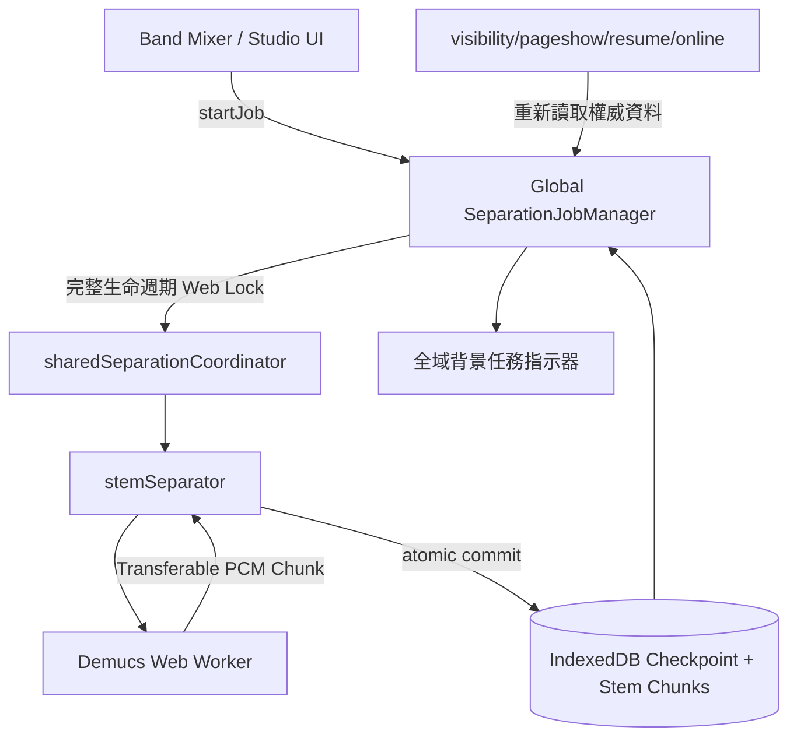

# 瀏覽器端背景分軌任務

## 架構變更

改版前，`BandMixer` 同時負責啟動 Demucs、顯示進度、頁面生命週期事件與 Worker 收尾；雖然 Chunk 已寫入 IndexedDB，路由切換仍讓任務控制面與畫面耦合。

改版後，既有 `sharedSeparationCoordinator` 仍是唯一的重型任務閘門；`SeparationJobManager` 只把它提升為應用程式層可訂閱的任務投影，沒有新增第二個 Worker 或平行排程器。`RootLayout` 的 `SeparationJobProvider` 常駐，Band Mixer 只訂閱任務投影。離開 Band Mixer 時不會 dispose 活躍的 separator；完成資料仍由每個 Chunk 的 IndexedDB 原子交易提交。

## 責任分工

| 元件 | 責任 |
| --- | --- |
| `SeparationJobProvider` | 只監聽生命週期並重新讀取任務投影；`hidden`、`freeze`、`pagehide` 不取消任務。 |
| `SeparationJobManager` | `startJob`、`pauseJob`、`resumeJob`、`cancelJob`、`getJob(s)`、`subscribe`；保留 UI 解除訂閱後的記憶體任務狀態。 |
| `sharedSeparationCoordinator` | 保持既有全域一次一個 Demucs 任務、generation 與清理節奏。 |
| `stemSeparator` / Worker | 連續執行推論；Worker 以 Transferable `ArrayBuffer` 傳遞 Chunk，主執行緒完成原子 Commit 後 ack。 |
| IndexedDB | Checkpoint、chunk checksum 與進度的權威來源；畫面百分比不是續跑依據。 |

## Web Locks、Lease 與恢復

- Web Locks 可用時，`withTaskLock` 覆蓋整個 `runJob`，不再只包住 Lease acquire；沒有 Web Locks 時安全降級為 IndexedDB Lease + generation fencing。
- Lease TTL 提升至 90 秒、heartbeat 為 20 秒，避免背景 timer 節流後過早接管。Chunk commit 仍同時驗證 `ownerTabId`、`ownerJobToken` 與 generation，因此恢復的舊 Worker 不能覆寫新執行者。
- `visibilitychange` hidden 不改寫成 `interrupted`，也不 terminate Worker 或釋放 Lease。回到 visible、`pageshow`、`resume`、`online` 僅重新讀取 Checkpoint；不直接呼叫 `startJob`，因此不會重複建立 Worker。
- 重新掛載 Band Mixer 時，以全域 job snapshot 同步顯示。既有 `validateAndPrepareResume` 仍負責 checksum、來源 hash、模型與 overlap carry 驗證，必要時只做一段 warmup。
- 手動暫停／取消的 Checkpoint 保留既有禁止自動續跑語意；資源檢查與 network budget guard 未被放寬。

## 背景與凍結限制

瀏覽器並不保證背景分頁、最小化或 OS 省電狀態仍可安排 Web Worker。此架構不使用靜音音訊、無限播放或 Service Worker 來規避政策。若 Worker 被凍結或頁面被回收，最近一次成功原子 commit 前的 Chunk 都不會遺失；恢復後須先依 Checkpoint 驗證、取得執行權，再由既有續跑流程接續。

目前 Worker Chunk commit 仍在主執行緒 IndexedDB transaction；Worker 不等待 UI render 才處理下一個 Chunk，但會等待 commit ack，以維持 generation 與原子性保證。這是刻意保留的正確性邊界。

## 驗證結果

- `npm test`：99 passed，0 failed（包含新增背景工作與 Web Lock 測試）。
- `npm run build`：成功。
- 新增測試涵蓋：立即 `preparing`、UI unsubscribe 後任務投影仍存在、active task 不重建、只允許已中斷且已登錄 runner 的自動續跑、背景容忍 TTL、完整 Web Lock 阻擋第二個 runner。
- 原有 `separation-chunk-checkpoint`、`separation-state-recovery` 測試持續涵蓋原子 commit、generation 防護、Chunk checksum、overlap warmup、completed 防降級與 interrupted checkpoint 續跑。

### 實機瀏覽器矩陣

| 環境 | 結果 |
| --- | --- |
| macOS Chrome | 本機頁面可編譯與回應 HTTP；此執行環境未取得可控制的新 Chrome 分頁與測試音檔，因此未做真實長時間背景 Demucs。 |
| Windows Chrome / Edge | 未取得環境，未驗證。 |
| Android Chrome | 未取得環境，未驗證。 |
| Safari | 未取得環境，未驗證。 |

上述未驗證項目不能由單元測試替代。正式驗收應記錄：啟動分軌時的 chunk 數與 checkpoint `updatedAt`，背景停留數分鐘後再比較 IndexedDB 的實際 chunk 數與時間；另將「背景期間確實完成」與「凍結後從 checkpoint 接續」分別記錄。

## 殘餘風險

- 純瀏覽器環境無法保證任何 OS、任何背景情境都不凍結推論。
- 完整頁面被 OS 回收時，進行中的 Worker 會停止；設計目標是保存已 commit 的 Chunk，而非保證當前 Chunk 完成。
- 不支援 Web Locks 的瀏覽器依賴 lease / generation fencing，能阻擋舊寫入但不能宣稱絕對不會重複推論。
- `resumeJob` 與自動續跑仍會回到已登錄的 Band Mixer 恢復入口，確保來源音訊、資源 admission 與網路預算檢查不會被 Provider 繞過；Provider 不會在背景隱藏狀態啟動它。
