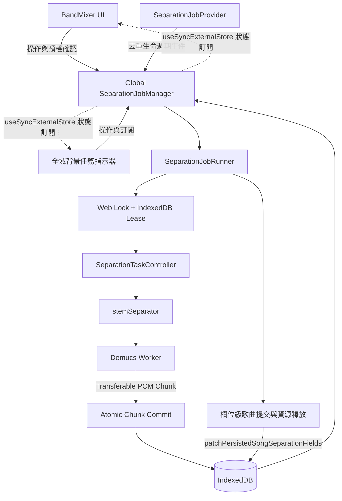
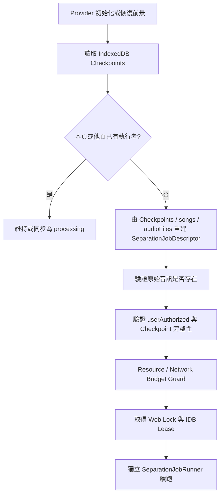
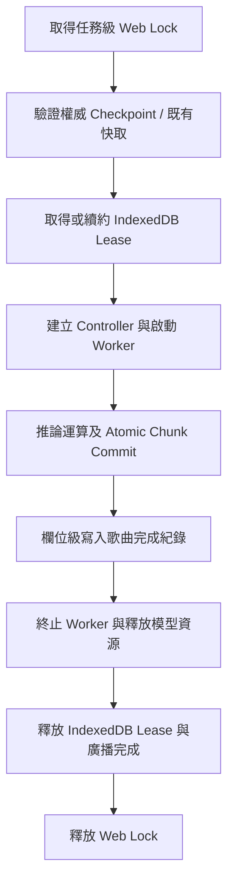
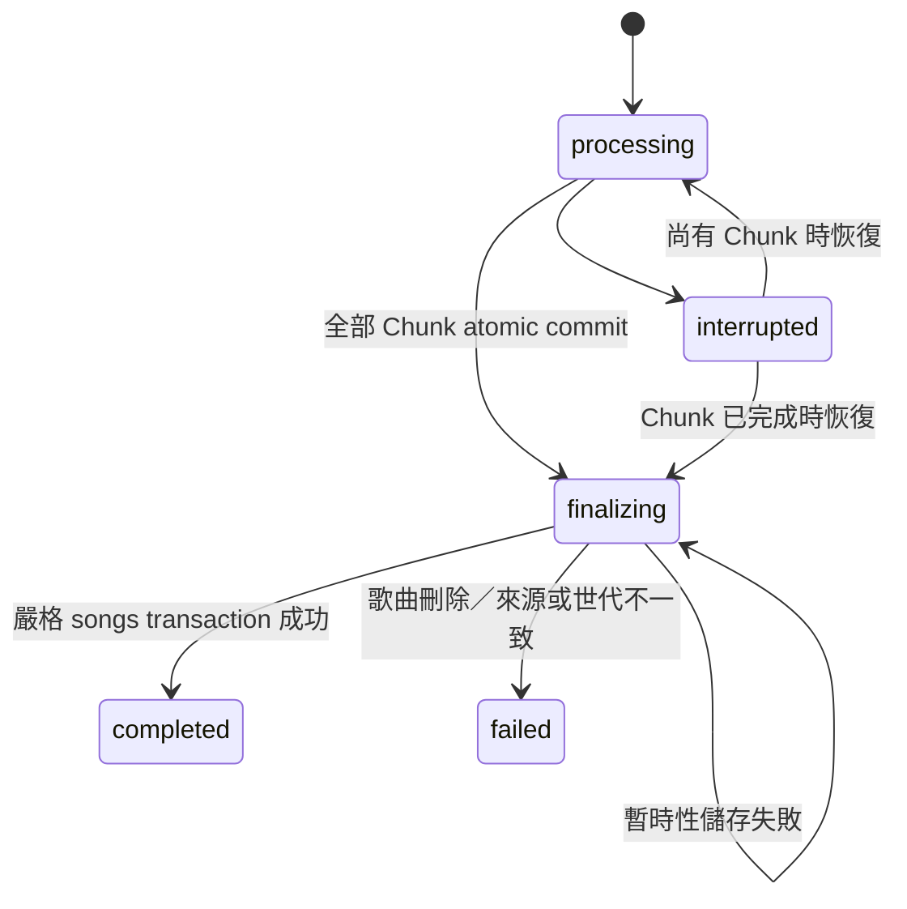

# 瀏覽器端背景分軌任務（第二階段：執行流程解耦與狀態安全）

## 一、架構演進

第一階段透過 `SeparationJobProvider`、`SeparationJobManager` 與全域任務指示器建立了應用程式層的狀態投影，但 `separateSong()` 與 `registerAutoResume` 仍留在 `BandMixer.tsx` 中，使得任務恢復仍依賴 `BandMixer` 掛載與元件閉包。

第二階段將執行、恢復、持久化提交與資源釋放完整抽離至獨立模組 `SeparationJobRunner` 與 `patchPersistedSongSeparationFields`：
- `BandMixer` 僅保留使用者操作、分軌模式選擇、互動確認彈窗（`ResourceGuardModal`）、UI 狀態訂閱與掛載播放引擎資源。
- 任務執行與自動恢復不再依賴特定 React 元件是否掛載；即使重新整理後直接停留在 `/studio`，系統仍可從 IndexedDB 重建任務描述並安全續跑。
- 全程維持純瀏覽器端運算（Demucs Web Worker + IndexedDB + Web Locks + BroadcastChannel），不引入任何後端運算服務。

## 二、Runner 與 Job Manager 責任分工

| 元件 | 核心責任 |
| --- | --- |
| `SeparationJobProvider` | 掛載於 `RootLayout`，監聽 `mount`、`visibilitychange`、`pageshow`、`resume`、`online` 並呼叫 `triggerLifecycleRecovery`；`hidden` 與 `freeze` 不取消 Worker。 |
| `SeparationJobManager` | 應用程式層任務管理器：`startJobController`、防降級 `updateJob`、跨分頁同步 `refreshFromStorage` / `refreshFromCheckpoint`、`pauseJob` / `cancelJob` / `resumeJob` / `requestAutoResume`、重試退避管理與全域 `globalFocusActive`。 |
| `SeparationJobRunner` | 無 UI 依賴的執行宿主：由 IndexedDB 重建 `SeparationJobDescriptor`、取得 Web Lock 並保護完整執行臨界區、計算 `sourceAudioHash`、驗證 Checkpoint 與快取、檢查 Resource / Network Guard、呼叫 `separateAudio`、處理暫停／取消／例外修復及釋放閒置模型。 |
| `patchPersistedSongSeparationFields` | 資料層欄位級原子合併：在背景進度與完成寫入 IndexedDB `songs` Store 時，只更新分軌相關欄位與補齊 `stemChannels`，完整保留使用者於分軌期間修改的 BPM、Key、音量、Loop 與 Playhead。 |
| `sharedSeparationCoordinator` / `stemSeparator` / Worker | 維持單一重型 Worker 並行度限制（同時最多 1 個 Demucs 推論）、Chunk Checksum 與主執行緒 ack 原子交易邊界。 |

## 三、任務描述重建（`SeparationJobDescriptor`）

不新增 IndexedDB Store，直接整合既有的 `separationCheckpoints`、`songs`、`audioFiles`（及尚未完成寫入前之 `transientSongAudioRegistry`）重建：

- **無原始音訊或未授權**：直接標記為需使用者處理（`requiresManualAction: true`、`autoResumeExhausted: true`），回傳 `blocked` 而不無限重試。
- **跨路由獨立恢復**：在 `/studio` 重新整理時，`SeparationJobProvider` 會在不掛載 `BandMixer` 的情況下自動完成重建與續跑，並透過 `patchPersistedSongSeparationFields` 提交完成狀態；待下次進入 `/band-mixer` 時再將分段音軌載入播放引擎。

## 四、Web Lock 與 Lease 完整生命週期

- **排他保護擴大**：`sharedSeparationLeaseManager.withTaskLock(taskId, ...)` 涵蓋驗證、Lease 取得、推論、最終提交與清理全程（禁止巢狀 Web Lock）。
- **Web Lock 探測與 Lease 協同**：Lease TTL 為 90 秒、Heartbeat 為 20 秒（不依賴 `BandMixer` 掛載）；若背景分頁因 timer 節流導致 `leaseExpiresAt` 暫時過期，其他分頁會透過 `isTaskLockHeld(taskId)` 非阻塞探測 Web Lock。只要 Web Lock 仍有效，就維持投影為執行中而不接管。
- **鎖定失敗語意**：Web Lock 取得失敗時，回傳 `{ status: "blocked", code: "lock_unavailable", retryable: true }`，絕不將歌曲標記為 `failed`，也不計入自動續跑失敗次數。
- **降級相容**：在不支援 `navigator.locks` 的瀏覽器上，自動降級為 IndexedDB Lease + Generation Fencing。

## 五、狀態映射、Generation 與防降級策略

1. **窮盡狀態映射（無 `processing` 預設 Fallback）**
   - `mapJobStageToSongSeparationStatus(stage)` 明確映射 `idle` / `preparing` / `downloading` / `processing` / `pausing` / `paused` / `cancelling` / `cancelled` / `completed` / `failed` / `interrupted`。
   - `completed` 固定映射為 `"completed"`。
2. **區分 Chunk 寫完與最終任務完成**
   - `onChunkCommitted` 期間即使寫完最後一段 Chunk，Job Manager 階段仍維持 `processing`（`progress <= 0.99`），必須等 IndexedDB `songs` Store 完成最終欄位合併提交後，才轉為 `completed`。
3. **防降級規則（`canTransitionJobStage` / `updateJob`）**
   - 阻擋過期 `generation`、同世代錯配 `ownerJobToken`、同一世代內 `completedChunks` 倒退。
   - 阻擋 `completed -> processing | interrupted | failed | paused | cancelled` 與 `cancelled -> processing | interrupted | failed`。
   - 若權威 Checkpoint 檢驗發現分段損毀需退回修復，須透過專用入口 `repairJobFromAuthoritativeCheckpoint` 執行並寫入 `recordSeparationDiagnostic` 紀錄。

## 六、跨分頁同步機制

- **輕量廣播**：透過 `BroadcastChannel`（`SEPARATION_LEASE_CHANNEL_NAME`）發送 `lease-acquired`、`task-progress`（僅含 taskId、generation、分段數與位元組數，不含 PCM）、`task-completed`、`task-paused`、`task-cancelled`、`task-failed` 與 `lease-released`。
- **權威對帳（`refreshFromStorage` / `refreshFromCheckpoint`）**：
  - 檢查全部分頁的真實狀態，包含已完成／已取消／已失敗終態，以及已從資料庫刪除的過期投影。
  - 同時檢查本地 `controller` 是否非終態（不僅是 `controllers.has(taskId)`）、IndexedDB Lease 與 Web Lock 持有狀態，正確區分「本分頁執行」、「他分頁執行（`isForeignActive`）」與「失去執行者的中斷任務」。
  - 若任務由另一分頁執行，本分頁的 `pauseJob` / `cancelJob` 安全返回 `false`，避免誤顯示已成功停止。

## 七、自動續跑重試與退避

- 預設上限與退避常數：`MAX_AUTO_RESUME_ATTEMPTS = 3`、`AUTO_RESUME_BACKOFF_MS = [5_000, 15_000, 60_000]`。
- 重試計數與退避時間持久化於 `localStorage`（`loop-harmonizer:auto-resume-retry:v1`），重新整理頁面不會歸零重試計數。
- **生命週期事件去重**：`triggerLifecycleRecovery` 以 in-flight 互斥鎖與去抖動合併連續觸發的 `visibilitychange`、`pageshow`、`resume`、`online`，確保不建立第二個 Worker。
- **計數重置與終止條件**：僅當有實質 Chunk 進展（`completedChunks > baselineCompletedChunks`）才重置連續失敗次數；Web Lock 被他頁持有或頁面隱藏不計入失敗；不可重試錯誤（欠缺音檔、未授權、預算超限）與手動 `paused`／`cancelled` 立即停止自動續跑並顯示需手動介入。

## 八、資源釋放與記憶體邊界

- 任務進入終態（`completed`、`cancelled`、`failed`、`paused`）後，`controllers` 立即清除已終止的 Controller，`autoResumeHandlers` 清除不再需要的句柄，並對歷史終態保留數量做上限裁切（`MAX_RETAINED_TERMINAL_JOBS = 24`）。
- 解除 UI 元件註冊（`subscribe` 返回之 unsubscribe）正確移除 `listeners` 且不影響執行中任務。
- `BandMixer` 卸載時若仍有全域執行中的背景分軌（`sharedSeparationJobManager.hasRunningHeavyTask()`），不得提前 `disposeStemSeparator`，直到 Runner 結束且無活躍任務時才釋放閒置模型／Worker。

## 九、測試與瀏覽器實測結果

### 1. 單元測試、整合測試與建置
- **`npx tsc --noEmit`**：通過（0 錯誤）。
- **`npm test`**：**108 / 108 通過**（0 失敗、0 略過），涵蓋：
  - `spec/background-separation-jobs.spec.mjs`：不掛載 `BandMixer` 完成分離、區分最後 Chunk 與最終提交、`completed` 階段映射、過期頁面重建 Descriptor 續跑、分軌完成保留使用者近期編輯（BPM/Key/音量/Loop）、generation／chunk 防降級與權威修復、跨分頁終態同步與清理、生命週期去重、手動暫停取消保護、重試上限／退避與清理後無殘留 Controller/Handler/Listener。
  - `spec/background-separation-lease.spec.mjs`：背景 Lease 過期但 Web Lock 有效時維持 `processing` 且阻擋他頁、Web Lock 失敗回傳 `blocked` 不標記為 `failed`。
  - `spec/separation-state-recovery.spec.mjs`：新增 `patchPersistedSongSeparationFields` 欄位級原子合併與防降級測試，並維持全部既有 18 項回復與資料安全性測試。
  - `spec/demucs-separation.spec.mjs`、`spec/separation-chunk-checkpoint.spec.mjs` 等 Chunk Checksum、Overlap Carry、2/4 Stem 正確性測試全數通過。
- **`npm run build`**：通過（Next.js 15 編譯與 7/7 靜態頁面輸出成功）。

### 2. 真實瀏覽器（macOS Google Chrome Headless）端到端 Demucs 驗證
使用真實 `htdemucs_embedded.onnx` 模型與本機 WAV 音檔執行 `node tmp/verify_background_separation_phase2.mjs`：

| 測試項目 | 實測操作與觀察數據 | 結果 |
| --- | --- | --- |
| **測試 A：站內路由切換** | `/band-mixer` 啟動 2-Stem 分離 → SPA 切換 `/` → `/studio` 期間全域指示器即時顯示 → `BandMixer` 卸載狀態下於 `/studio` 完成 `2/2` chunks 並寫入 `songs` 完成態 → 切回 `/band-mixer` 無需重算並可正常播放 | 通過 |
| **測試 B：瀏覽器背景分頁（30s WAV）** | 啟動後提交 `nextChunkIndex=1`（`updatedAt=1795021311729`）→ 將第 2 個分頁切至前景停留約 10.3 秒 → 切回原分頁確認已完成 `6/6` chunks（`updatedAt=1795021322022`，`elapsedMs=10293`） | 通過（註：headless Chromium 下 `bringToFront` 後分頁 `document.visibilityState` 仍維持 `"visible"`，非真實 OS 視窗遮蔽節流） |
| **測試 C：重新載入並直入 `/studio` 獨立恢復** | 分離至 `1/6` chunk 處強制 `goto(/studio)` 重新載入（未進 `BandMixer`）→ `/studio` 上的 `SeparationJobProvider` 由 IndexedDB 重建 Descriptor 並自動接續完成至 `6/6` chunks 與 `songs` 完成態 | 通過 |
| **測試 D：跨分頁執行鎖與同步** | 分頁 A 啟動 30s WAV 分離並取得 Lease/Lock → 同上下文分頁 B 開啟 `/band-mixer` 顯示忙碌鎖定且未標記 `failed`／未重複啟動 Worker → 分頁 A 完成後分頁 B 自動同步為「分段分離完成」 | 通過 |

### 3. 尚未驗證的環境
| 環境 | 狀態與原因 |
| --- | --- |
| 非 headless 桌面 Chrome／Edge（視窗最小化／實際 `visibilityState=hidden`） | 未取得有頭桌面視窗互動環境；headless Chromium 未觸發 OS 層背景分頁深度節流，尚未實測長音檔最小化數分鐘是否完成或凍結續跑。 |
| Android Chrome 實機 | 未連接實體裝置，尚未驗證鎖屏後 OS 省電節流與前景自動續跑手感。 |
| Safari / iOS WebKit | 未驗證（特別針對 `navigator.locks` 缺省或頁面生命週期差異之表現）。 |

## 十、剩餘風險與限制

1. **作業系統背景節流／凍結**：瀏覽器仍可能在 OS 省電、休眠或鎖屏下暫停 Web Worker；本設計仰賴每段 Atomic Chunk Commit 保證已算段落不遺失，恢復前景後從最近有效 Checkpoint 安全續跑，而非阻止系統休眠。
2. **主執行緒 Commit ACK 邊界**：Chunk 仍透過 Transferable 傳回主執行緒進行 IndexedDB atomic transaction（以維持 Checksum 與 generation fencing 一致性）；若未來實機實測確認主執行緒背景 timer 節流造成 commit ack 延遲成為瓶頸，才考慮下一階段將 IndexedDB Chunk commit 移入 Worker 執行。
3. **跨分頁控制權限制**：若分頁 B 檢視分頁 A 正在執行的任務，目前採安全鎖定不允許由分頁 B 偽裝暫停或取消成功，須回到持有執行權的分頁或待該任務凍結釋放鎖後再行接手。

## 十一、第三階段：最終提交與自動恢復補強

`completed` 現在只代表「分軌產物、歌曲紀錄與必要播放欄位均已一致提交」；Checkpoint 的 `completed` 僅表示所有 Chunk 已通過驗證。

- `commitPersistedSongSeparationFinalization` 在單一 `songs` transaction 內確認歌曲存在、`taskId`、來源 hash、模型／處理版本、模式與狀態轉移，並以 discriminated union 回傳 `committed`、`already_committed`、`song_missing`、`stale_generation`、`source_mismatch` 或 `transition_rejected`。它不吞掉 IndexedDB 錯誤。
- Runner 會在最後一段後投影 `finalizing`（99%），只有上述嚴格提交成功後才呼叫 `markCompleted`、廣播 `task-completed`、釋放舊產物引用。最終提交失敗會保留有效 Chunk；下次恢復會走零推論的既有 Checkpoint 路徑。
- 跨分頁 `refreshFromCheckpoint` 一律重讀歌曲紀錄：完整 Chunk 但歌曲結果未提交時顯示 `finalizing`，不再只依 Broadcast 或 Checkpoint status 顯示完成。
- Job Manager 使用單一 `retryWakeupTimer` 掃描持久化 `nextEligibleAt`；到期後重新驗證生命週期與執行權。背景節流只會延後該喚醒，不會產生 polling 或多個 timer。finalizing 與 interrupted 都可進入同一安全恢復入口，因此完整 Chunk 的重試不會建立 Demucs Worker 或重新下載模型。

本階段新增 `spec/separation-finalization.spec.mjs` 與 `spec/separation-resume-scheduler.spec.mjs`，並擴充跨分頁測試以確認「Chunk completed → finalizing」的權威投影及單一最早到期 retry timer。最新本機驗證：`npm test` 110/110 通過、`npx tsc --noEmit` 通過；實際 UI smoke test 已確認 Band Mixer／首頁／Studio 路由與節拍器互動，未載入真實歌曲，因此 finalizing 與真實 hidden／凍結仍列為未驗證。
